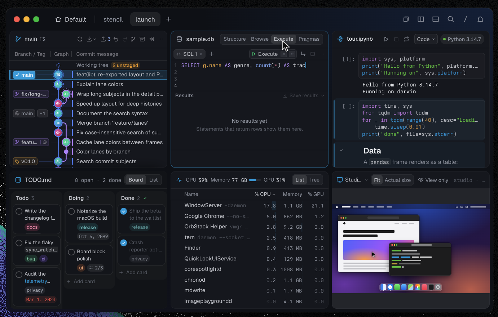

I have been trying to come up with a unified theory of how engineering tools are changing and what kind of tools I would
like to use personally. And I think I finally have an answer.

All these are downstream from Thorsten Ball's world of software engineering [^1]. I agree with everything he has listed,
his post caused a lot of stir on X, but I feel he is directionally very correct.

Since 2026 started, I have barely written code manually in a file, I have spent a lot more time time reading code and
doing a ton of experiments. It has been fun to force myself to 10x my ambition. I recently switched jobs and moved into
a team where my role is more of research engineering, with that change, I find myself doing a lot of experiments and
trying to evaluate and argue about research directions which eventually become features in a product/system.

I also join meetings, give presentations, discuss issues with my colleagues, talk to customers, look at transcripts of
customer calls I was not a part of, attend architecture meetings, RFC discussions etc. All of this while trying to
manage a fleet of agents that are sustainably pushing research and system implementations in an aligned direction.

And with all these changes, I have grown to hate the tools I was using on a daily basis. Raw dogging claude code on
ghostty has been very annoying.

## Text Buffers to Cloud Agents

Software engineering tools have evolved around the text editor, everything was done to make sure you could add code in a
file. JetBrains, Vim, Sublime, Visual Studio, VS Code, Zed etc.

<!-- prettier-ignore -->


Even the early versions of cursor were built around the text buffer of a file, so you could see the changes AI was
making to your file. Thanks to claude code, we moved on to a workflow where you are not reading the code most of the
time.

The most primitive software engineering setup today is splitting your terminal and then running separate claude code
sessions in different worktrees, and then you are looking at multiple chat windows where your agent is working.

If you are a bit more sophisticated you probably have an ADE (agentic dev environment) like superset, conductor, orca,
herdr etc. And these interfaces are designed around two primary actions, you need to have some way of creating a task
(which creates a worktree) and then spawn an agent in it.

Agent notifications also are a thing now, if an agent needs you, the ADE will notify you and clicking it takes you to
the session, where you can inspect the chat and then proceed further. A lof of engineers run some version of this setup
with a few MCPs on top of this to bring in context from different tools.

If you work at a company with abundant tokens, you also have access to some way of running agents in the cloud, a
platform that can take instructions for you and run your agent while taking care of the sandbox spinning, git and github
access etc for you.

It’s an interesting time to observe the advances in these tools because they are all trying to solve for a major shift
in our work pattern, of going from writing and reading code to interacting with agents and their outputs, and perhaps
reviewing code at the end.

With an ADE setup, you can easily run a dozen agents at once and try to divide work among them. Going from zero to a
dozen agents is the hardest, it's a fundamental shift in how you work, but going from a dozen to hundreds is relatively
easy. The more you parallelize, you need the agents to start and only go to them once they have finished a task, in
between you can context switch while they work to make better use of your time.

Looking at an agent do work is a waste of time and an anti-pattern. If you are looking at the agent just do work, it
mostly means you don’t have enough confidence in the work it’s doing or you don’t have enough guardrails that’d stop the
agent from doing something harmful, something on the tunes of deleting a full dev k8s cluster just because it was trying
to clean something up. You want to get into a rhythm where you keep spawning agents, give them tasks and burden them
with producing irrefutable proof that whatever they have done works and is correct, this has brought formal verification
back in vogue.

A big part of inspecting this "irrefutable proof" looks a lot like data analysis, the agent probably has run a bunch of
tests and it dumped all the test results in a sqlite or a JSON file. The agent pings you, says that it’s done, you look
at the JSON file, maybe ask it to plot some charts or some HTML UI to viz that JSON file. You look at it from multiple
angles, things make sense, you ask it to create a PR. Multiply this workflow by a dozen agents, you quickly have this
situation where your whole day is just jumping from worktree to worktree, looking at different reports and analyzing
work. Testing things and then back to your central context place to write more to drive the next set of agents.

You are working on multiple initiatives, some of them are perhaps product focused, some are research focused, some are
just like throwaway exploration that an agent is doing so that you can use it to understand the further direction you
want to take. It’s a good mix of all this.

I know a lot of people live an extreme of this way of working by running 100s of agents with automated loops that spawn
themselves and keep working endlessly. But a lot of times even the loops need some maintenance because the underlying
problem has shifted, or maybe you have discovered a new source of data that needs to be used to influence the loop or
something. So you are always in this mode of writing material to influence agents so they can do their work.

So now, the work is a mix of writing, data analysis and engineering. It used to be like this earlier as well, but we
used to do data analysis maybe once a week, but now its every other hour.

## Bloomberg Terminals

As someone who is trying to get more and more done using AI as much as they can, I have found some interesting parallels
between our engineering and the trading world.

The bloomberg terminal is a tool used by all of the big banks and hedge funds to basically look at market data. It costs
around \$30k USD per year, and it’s a darling tool for most professional traders who do trade for a living.

You have probably seen it in movies like the big short, the margin call, even alex wang has a
[bloomie](https://x.com/alexandr_wang/status/2105052032126292279?s=20).

There is a lot of commentary on whether the price is justified or not. There have also been a lot of pointless attempts
to vibe code a free alternative to it but most people who try to do it completely miss the point of how much work goes
behind making that black and yellow app work. The real work that makes the bloomberg terminal useful is the mountain of
work bloomberg does as a tech company to unify and serve all the data feeds that exist in the finance universe, this
involves everything from news data, weather data, tickers for every single financial instrument on the planet and things
like that.

I learned about the bloomberg terminal when I watched the big short in high school and had just made a zerodha account
to trade in the Indian markets. Now as a research engineer I appreciate it even more. You see, the bloomberg terminal is
the best inspiration we have for what kind of tools we should be building for the software engineers of the future.

When information was scarce and local, a trader’s edge came from relationships, being physically on the floor and
hearing news first. The job was about voice, reading the tape and knowing the right dealer. Bloomberg standardized that
information and made it widely available, shifting the edge toward analysis and the network on the terminal, which
became a status symbol at roughly $25–30k a year per seat.

Today, execution is largely automated, and the edge comes from data, models, latency and risk management. Human traders
handle large, illiquid or complex trades, manage the algorithms and still use Bloomberg chat for OTC negotiation.

I am deeply inspired by the bloomberg terminal because it enables this sort of lightning fast experience when it comes
to analyzing a lot of information quickly to make decisions.

In the bloomberg terminal, you can hit a few keystrokes and be looking at the stock price of something like \$NVDA, hit
a few more and you are looking at the bar chart of their quarterly earnings report, hit a few more and you are able to
co-relate it with the stock prices of their suppliers.

When traders live in that world, why can’t we build tools that allow me to quickly spawn a new worktree + an agent in a
few keystrokes, and then look at the 5xx error percentage of that service in staging and in prod in another few
keystrokes, and then also look at customer tickets related to that error in a few more keystrokes, all without leaving
my terminal, all of this brought to me in a consistent visual interface so I don’t have to look at a new kind of purple
html file for every data ask I have around a task.

It’s basically data-driven decision making at the speed of keystrokes with a meta-harness that is able to unify data
feeds and give information to you and your agents super fast.

We need a new set of primitives that support this new way of working which is a bit more integrated than just having a
terminal split 16 ways, and then a slew of code editor windows that need to be opened and closed all the time along with
a bunch of HTML or BI reports and sqlite files that are constantly created and re-created from scratch because all of
your agents are doing everything on their own.

You need a tool that fits all of this and something that also allows for some kind of self-extension by the way of
plugins, and you can vibe code your own set of plugins that can help you process a lot of information at once.

Because, in my opinion, the bottleneck is not the code review anymore, it’s staying on top of all the work that your
agents are doing. It’s easy to claim that “oh just re-engineer all of your work to look like a hill climbing task” but
the reality is that not everything is that easy to turn into a verifiable domain, there will always be things that you
will have to step in and apply judgement or review the judgement the agent is performing on your behalf.

Building a fully autonomous dark software factory is a bit of a long shot because you still are not as involved, and
fully automating it to run in the dark might not be the right way. A lot of the work still falls in this messy middle
where you slowly turn initiatives into good, approved hill climbing loops and then let them run semi-supervised, I don’t
see a lot of merit to completely keep a team out of the loop for a software factory. Chat interfaces to do all this is
too simple and primitive.

## Superterminals: Tern and Rex

With all these changes, I think we are entering the superterminal era of software engineering. The terminal is no longer
just where you run commands; it is becoming the workspace where you direct agents, inspect their outputs and decide what
happens next.

A superterminal needs client/daemon separation so that sessions outlive the window, along with a way to start multiple
shells and organize them, preferably in a hierarchy. This client/daemon setup gives you very good support for multi-host
work, you can direct work on multiple machines very easily.

It should also let you open and read files quickly, especially Markdown, without leaving the workspace.

It also needs a plugin ecosystem for creating custom views and a native meta-harness that can inspect what is happening
across every shell session. When you have many agents running at once, the problem is not just managing their terminals;
it is making sense of all the information they produce. An extensible system of blocks lets you bring that information
into the workspace, and build new views on the fly as you need them.

If you have these primitives, it gives you all the tools and surface area you needs to ensure that you can build your
own bloomberg terminal.

There are two tools at the time of writing that fit this description. It's
[Tern by Stencil](https://stencil.so/tern)[^2] and
[Rex by Superlogical](https://www.superlogical.com/rex/docs/installation)[^3].

.")

| Feature                                        | Tern | Rex |
| ---------------------------------------------- | :--: | :-: |
| Separate client and session daemon             | Yes  | Yes |
| Sessions persist after closing the window      | Yes  | Yes |
| Named sessions, tabs and split panes           | Yes  | Yes |
| Connect to sessions on remote hosts            | Yes  | Yes |
| CLI/API control of panes and layouts           | Yes  | Yes |
| Agent-accessible inspection of workspace state | Yes  | Yes |
| Custom block plugins                           | Yes  | Yes |
| Built-in rendered Markdown view                | Yes  | No  |
| Built-in browser panes                         | Yes  | No  |
| Built-in Git graph and diff views              | Yes  | No  |
| Built-in SQLite browser and query results      | Yes  | No  |

I have thoroughly enjoyed using Tern over the past few weeks as my ADE, I use it at work and also for my personal setup.
It's been fun to vibe code different plugins in luau and mould this terminal exactly how I want it. I have made two of
my plugins public

- https://github.com/junaidrahim/tern-bigquery
- https://github.com/junaidrahim/tern-software-factory

I want to find out how much work I can take on without losing track of what I’m responsible for. Starting another agent
is easy enough now. What takes time is understanding what it did, checking whether it worked and deciding where to go
from there. I’m enjoying shaping Tern around that part of my day. There’s still plenty to figure out, but being able to
build the views I need beside the agents doing the work feels like a useful place to start.

You need a manager for infinte minds. You need a superterminal.

[^1]:
    [Thorsten's views on the future of software engineering](https://x.com/thorstenball/status/2101305394190557466?s=20)

[^2]:
    Tern: [product overview](https://stencil.so/tern), [plugin SDK](https://docs.stencil.so/tern/), and
    [scripting and block catalogue](https://docs.stencil.so/tern/scripts/index.html). The rich-view rows are documented
    under [file blocks](https://docs.stencil.so/tern/scripts/file.html),
    [browser blocks](https://docs.stencil.so/tern/scripts/browser.html),
    [Git blocks](https://docs.stencil.so/tern/scripts/git.html), and
    [SQLite blocks](https://docs.stencil.so/tern/scripts/sqlite.html).

[^3]:
    Rex: [CLI reference](https://www.superlogical.com/rex/docs/reference/cli),
    [agent integration](https://www.superlogical.com/rex/docs/automate/agent-skill),
    [Mac actions](https://www.superlogical.com/rex/docs/reference/mac-actions), and
    [public testing announcement](https://www.superlogical.com/updates/public-testing-beginning).
